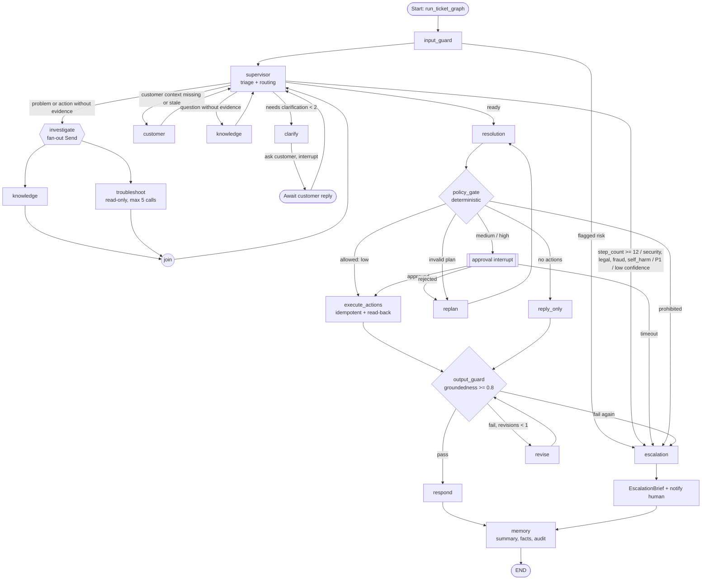
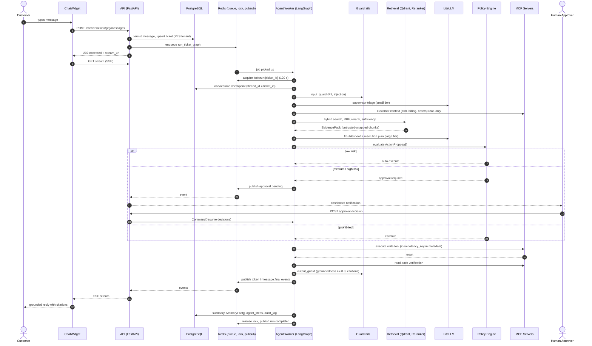
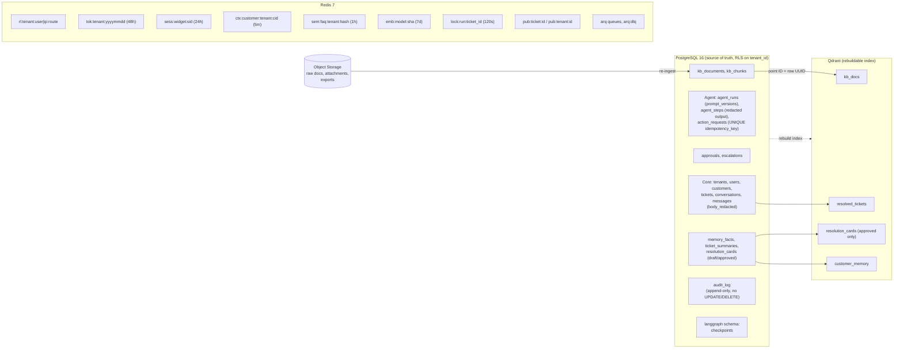
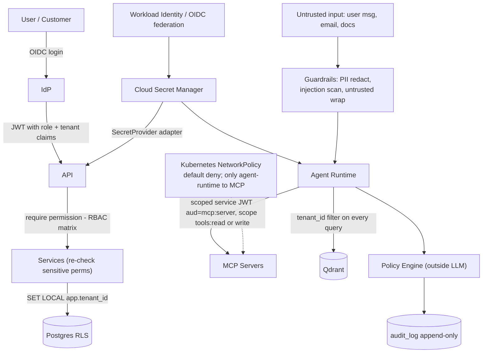
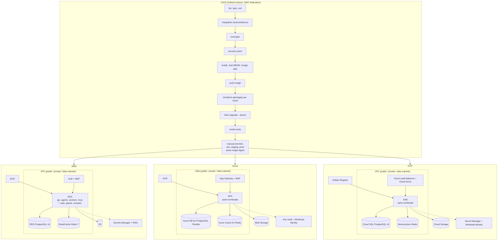
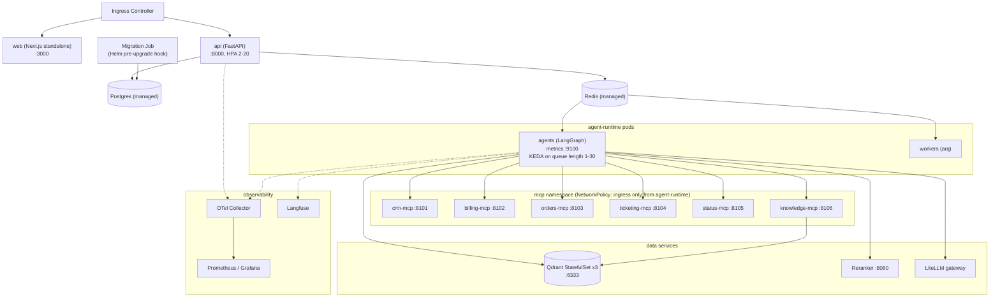

# ACSRP — Architecture Document

**Autonomous Customer Support & Resolution Platform** (working folder: `resolva`)
Version 1.0 · Status: Design phase · Companion to PRD/BRD, HLD, LLD in this folder.

> **How to use this with Eraser.io:** every diagram below is a self-contained Mermaid block.
> In Eraser, open a new diagram → *AI / Import* → paste one Mermaid block (or paste the whole block plus the prompt in §14).
> Diagrams are split by level (system, component, agent graph, data, infra) because Eraser renders smaller, focused diagrams more cleanly than one giant one. Diagram 1 is the complete end-to-end view.

---

## 1. Purpose and Scope

ACSRP acts as a production "AI Customer Resolution Engineer". For every support request it runs:

> **Understand → Investigate → Retrieve → Decide → Act → Escalate → Remember**

It classifies the ticket, retrieves grounded evidence, pulls customer context, diagnoses, builds a resolution plan, executes governed actions through MCP tools, escalates risky cases to humans, and learns from resolved tickets. The same container images deploy to AWS, Azure and GCP via Terraform.

**Out of scope for v1.0:** voice/telephony, more than one helpdesk adapter, model fine-tuning, multi-language UI, real payments (billing MCP hits a sandbox).

## 2. Architectural Principles (Non-Negotiable Invariants)

| # | Principle | Mechanism |
|---|---|---|
| 1 | The LLM never executes anything directly | `ActionProposal → policy_gate → (approval) → execute_actions_node → MCP`; tool registry enforces who may call write tools |
| 2 | Policy engine runs outside the LLM (ADR-07) | Deterministic YAML rules, `simpleeval` evaluator, auditable |
| 3 | Every action is idempotent | Key `ticket_id:tool:stable_hash(args)`, UNIQUE on `action_requests.idempotency_key` |
| 4 | Tool args validated twice | Pydantic `input_model` + provenance check (IDs/amounts from context, never free text) |
| 5 | Untrusted content is data | `<untrusted>` wrapping, injection scan, flagged chunks dropped |
| 6 | Grounded replies | Citations by `chunk_id`, groundedness judge ≥ 0.8, max 1 revision then escalate |
| 7 | Structured outputs everywhere | `structured()` helper, temp ≤ 0.2, repair-retry then escalate |
| 8 | Tenant isolation | `tenant_id` on every table + Postgres RLS + `SET LOCAL app.tenant_id`; vector queries filtered by tenant |
| 9 | Append-only audit | App DB role has no UPDATE/DELETE on `audit_log` |
| 10 | No PII in logs/traces | structlog redaction processor, `body_redacted` |
| 11 | No secrets in code/images | `SecretProvider` adapter, workload identity, OIDC federation in CI |
| 12 | Cloud code behind adapters | `ObjectStore`, `SecretProvider`, `EmailSender` selected by `settings.cloud` |
| 13 | Loop and cost limits | `MAX_STEPS=12`, ≤5 troubleshooting calls, ≤2 clarifications, ≤2 retrieval rounds, token budgets (alert 80%, copilot-only 100%) |
| 14 | Graceful degradation | retry → fallback model → circuit breaker → `degraded`; tickets never lost |

## 3. System Context (who talks to the platform)

| Actor / System | Interaction |
|---|---|
| Customer | Embeddable chat widget (SSE), email, API |
| Support Agent / Supervisor | Next.js dashboard: inbox, approvals, escalations |
| Admin / Platform Engineer | Knowledge, policy, tool, user, tenant admin; observability |
| Ticketing system (mock Zendesk/Jira) | Webhook in, ticketing MCP out |
| CRM, Billing (sandbox), Orders, Status page | Via MCP servers only |
| Identity Provider (OIDC; Keycloak locally) | AuthN, JWT claims → RBAC |
| LLM providers | Via LiteLLM gateway (swappable for VexaRoute) |

---

## 4. Diagram 1 — Complete System Architecture

```mermaid
flowchart TB
    %% ============ CLIENTS ============
    subgraph CLIENTS["Channels and Clients"]
        direction LR
        CUST["Customer"]
        WIDGET["ChatWidget<br/>(Web Component, Shadow DOM, SSE)"]
        EMAIL["Inbound Email"]
        TICKSYS["Ticketing System Webhook<br/>(mock Zendesk/Jira)"]
        DASH["Next.js 15 Dashboard<br/>inbox, tickets, approvals,<br/>escalations, analytics, admin"]
        AGENTUSER["Support Agent / Supervisor / Admin"]
        CUST --> WIDGET
        CUST --> EMAIL
        AGENTUSER --> DASH
    end

    %% ============ EDGE ============
    subgraph EDGE["Edge and Identity"]
        direction LR
        CDN["CDN / WAF"]
        LB["Ingress / Load Balancer<br/>TLS"]
        IDP["OIDC IdP<br/>(Keycloak local, cloud IdP)"]
    end

    %% ============ API ============
    subgraph APISVC["API Service (FastAPI, Uvicorn) - HPA 2-20"]
        direction TB
        MW["Middleware<br/>auth JWT, RBAC require(), rate limit,<br/>X-Request-ID, tenant context, RFC 9457 errors"]
        ROUTERS["Routers /api/v1<br/>tickets, messages, approvals, admin,<br/>auth, analytics, widget, channels"]
        SERVICES["Services<br/>ticket, approval, memory, ..."]
        REPOS["Repositories<br/>SQLAlchemy 2 async + asyncpg"]
        CHAN["Channel Adapters<br/>email, webhook (HMAC + 5 min skew),<br/>ticketing"]
        RT["Realtime Manager<br/>SSE / WebSocket"]
        MW --> ROUTERS --> SERVICES --> REPOS
        CHAN --> SERVICES
        SERVICES --> RT
    end

    %% ============ QUEUE ============
    subgraph QUEUE["Async Backbone (Redis 7)"]
        direction LR
        ARQ["arq queue<br/>run_ticket_graph, ingestion, summaries,<br/>evals, SLA timers"]
        DLQ["arq:dlq<br/>dead-letter"]
        PUBSUB["Pub/Sub<br/>pub:ticket:id, pub:tenant:id"]
        LOCK["lock:run:ticket_id (120 s)"]
        CACHE["Caches<br/>ctx:customer, sem:faq, emb:model:sha"]
        RL["Rate limit token bucket (Lua)<br/>tok budget counters"]
    end

    %% ============ AGENT RUNTIME ============
    subgraph AGENTS["Agent Runtime (LangGraph worker) - KEDA 1-30"]
        direction TB
        IGUARD["input_guard<br/>PII (Presidio), injection classifier"]
        SUP["Supervisor<br/>triage + deterministic routing"]
        CUSTA["Customer Agent"]
        INVEST["Investigate (fan-out via Send)"]
        KNOW["Knowledge / RAG Agent"]
        TROUB["Troubleshooting Agent<br/>read-only, max 5 tool calls"]
        RES["Resolution Agent<br/>ResolutionPlan + ActionProposal[]"]
        CLAR["Clarify"]
        ESC["Escalation Agent<br/>EscalationBrief"]
        PGATE["policy_gate<br/>Policy Engine (YAML, simpleeval)"]
        EXEC["execute_actions_node<br/>idempotent + read-back verify"]
        OGUARD["output_guard<br/>groundedness judge >= 0.8,<br/>citations, policy promises"]
        MEMN["memory node<br/>summary + facts write-back"]
        IGUARD --> SUP
        SUP --> CUSTA
        SUP --> INVEST
        SUP --> KNOW
        SUP --> CLAR
        SUP --> ESC
        INVEST --> KNOW
        INVEST --> TROUB
        SUP --> RES
        CUSTA --> SUP
        KNOW --> SUP
        TROUB --> SUP
        RES --> PGATE
        PGATE --> EXEC
        PGATE --> ESC
        EXEC --> OGUARD
        PGATE --> OGUARD
        OGUARD --> MEMN
        OGUARD --> ESC
        ESC --> MEMN
    end

    subgraph AGENTLIB["Agent Runtime Libraries"]
        direction LR
        PROMPTS["Versioned Prompts (.md + metadata)"]
        REGISTRY["Tool Registry<br/>agent allow-lists, input models"]
        LLMGW["LLM Client<br/>tier routing small/medium/large,<br/>fallbacks, cost, circuit breaker"]
        RETR["Retrieval Pipeline<br/>rewrite, hybrid, RRF, rerank, sufficiency"]
        MCPC["MCP Client<br/>streamable HTTP, scoped service JWT"]
    end

    %% ============ MCP ============
    subgraph MCP["MCP Tool Servers (FastMCP, cluster-internal, 8100+)"]
        direction LR
        MCRM["crm-mcp"]
        MBILL["billing-mcp<br/>(sandbox)"]
        MORD["orders-mcp"]
        MTICK["ticketing-mcp"]
        MSTAT["status-mcp"]
        MKNOW["knowledge-mcp"]
    end

    %% ============ DATA ============
    subgraph DATA["Data Plane"]
        direction LR
        PG[("PostgreSQL 16<br/>OLTP, RLS, audit_log,<br/>langgraph checkpoints schema")]
        QD[("Qdrant<br/>kb_docs, resolved_tickets,<br/>resolution_cards, customer_memory")]
        OBJ[("Object Storage<br/>S3 / Blob / GCS<br/>docs, attachments")]
        SEC["Secret Manager<br/>via SecretProvider"]
    end

    %% ============ MODELS ============
    subgraph MODELS["Model Services"]
        direction LR
        LITELLM["LiteLLM Gateway"]
        LLMP["LLM Providers<br/>(placeholders in config/models.yaml)"]
        EMB["Embeddings<br/>text-embedding-3-large / bge-m3"]
        RERANK["Reranker :8080<br/>bge-reranker-v2-m3 / Cohere"]
        LITELLM --> LLMP
    end

    %% ============ WORKERS ============
    subgraph WORKERS["Background Workers (arq)"]
        direction LR
        INGEST["Ingestion<br/>chunk, embed, index"]
        SUMM["Summaries and Card Distillation"]
        EVALW["Eval Runner"]
        SLA["SLA / Approval Timers"]
    end

    %% ============ OBSERVABILITY ============
    subgraph OBS["Observability"]
        direction LR
        OTEL["OpenTelemetry Collector"]
        LANGFUSE["Langfuse<br/>LLM traces and cost"]
        PROM["Prometheus + Grafana<br/>acsrp_* metrics"]
        LOGS["Structured Logs (structlog JSON, redacted)"]
    end

    %% ============ WIRING ============
    WIDGET -->|HTTPS + SSE| CDN
    DASH -->|HTTPS + WS| CDN
    EMAIL -->|inbound| CHAN
    TICKSYS -->|HMAC webhook| CHAN
    CDN --> LB --> MW
    DASH -.->|OIDC login| IDP
    MW -.->|verify JWT / JWKS| IDP

    SERVICES -->|enqueue 202 + stream_url| ARQ
    MW --> RL
    RT <--> PUBSUB
    REPOS --> PG

    ARQ --> LOCK
    ARQ --> AGENTS
    AGENTS -->|events| PUBSUB
    AGENTS -->|checkpoints AsyncPostgresSaver| PG
    AGENTS --> AGENTLIB
    LLMGW --> LITELLM
    RETR --> QD
    RETR --> EMB
    RETR --> RERANK
    RETR -.->|fallback FTS| PG
    RETR --> CACHE
    MCPC -->|JWT aud=mcp:server| MCP
    REGISTRY -.->|enforces write-tool allow-list| MCPC
    PROMPTS -.-> AGENTS

    MCP --> MKNOW
    MKNOW --> QD
    MCRM --> EXT1["CRM system"]
    MBILL --> EXT2["Payments sandbox"]
    MORD --> EXT3["Order / logistics system"]
    MTICK --> TICKSYS
    MSTAT --> EXT4["Status page"]

    MEMN --> PG
    MEMN --> QD
    WORKERS --> ARQ
    INGEST --> OBJ
    INGEST --> QD
    INGEST --> PG
    INGEST --> EMB
    SUMM --> PG
    SUMM --> QD

    APISVC -.-> SEC
    AGENTS -.-> SEC
    MCP -.-> SEC

    APISVC -.-> OTEL
    AGENTS -.-> OTEL
    MCP -.-> OTEL
    AGENTS -.-> LANGFUSE
    OTEL --> PROM
    OTEL --> LOGS
```



---

## 5. Component-Level Explanation

### 5.1 Clients and Channels
| Component | Responsibility | Notes |
|---|---|---|
| ChatWidget | Customer chat; React-built Web Component, Shadow DOM, SSE for streaming | Session in `sess:widget:{sid}` (24 h) |
| Email channel | Inbound email → message; dedupe by `Message-ID` | Webhook HMAC + timestamp (5 min skew) |
| Ticketing webhook | Syncs ticket events from the mock helpdesk | `/channels/ticketing/webhook` |
| Dashboard (Next.js 15) | Routes `/inbox`, `/tickets/[id]`, `/approvals`, `/escalations`, `/analytics`, `/admin/*` | TanStack Query, Zustand, next-auth; WCAG 2.1 AA; role-aware UI, server is authority |

### 5.2 API Service (`apps/api`)
- **Layering:** thin routers → services (business logic, re-check sensitive permissions, e.g. `approval:decide:high`) → repositories (DB).
- **Middleware:** JWT verification, `require("<permission>")` RBAC (roles: `customer, agent, supervisor, admin, platform_engineer, service`), token-bucket rate limiting, `X-Request-ID`, `traceparent`, RFC 9457 Problem Details.
- **Tenant context:** `SET LOCAL app.tenant_id` per transaction, enforced by Postgres RLS.
- **Realtime:** SSE/WebSocket manager bridging Redis pub/sub to clients. SSE events: `run.started, node.started, token, citation, action.proposed, approval.pending, action.executed, escalated, message.final, run.completed, error`.
- **Pagination:** cursor-based; messages deduped by `client_message_id`.

### 5.3 Agent Runtime (`apps/agents`)
LangGraph supervisor pattern with typed `TicketState` (reducers: `add_messages`, `operator.add` for `action_results`, `route_history`, `guardrail_flags`). `thread_id = ticket_id`; checkpoints in Postgres (`langgraph` schema).

| Agent / Node | Output schema | Tools | Model tier |
|---|---|---|---|
| input_guard | flags | Presidio, injection classifier | small |
| Supervisor | `Triage` + route | none | small |
| Customer | `CustomerContext` | crm, billing, orders, ticketing, memory (read) | none/small |
| Knowledge / RAG | `EvidencePack` | knowledge-mcp, vector DB | small + rerank |
| Troubleshooting | `Diagnosis` | read-only diagnostics, ≤5 calls, stop at confidence ≥ 0.75 | large |
| Resolution | `ResolutionPlan` (`ActionProposal[]`) | **only agent allowed write tools** (through policy) | large |
| Escalation | `EscalationBrief` | ticketing, notifications | medium |
| policy_gate | decision per action | none (deterministic) | n/a |
| execute_actions | `action_results` | MCP write tools, read-back verify | n/a |
| output_guard | pass / revise / escalate | groundedness judge | small |
| memory | summary + `MemoryFact[]` | Postgres, Qdrant | small |

**Supervisor routing (in code, not prompts), in order:**
1. `step_count >= 12` → escalation
2. Risk flags `security|legal|fraud|self_harm`, or P1 → escalation
3. Needs clarification with < 2 prior clarifications → clarify
4. Customer known but context missing/stale (> 5 min) → customer
5. `question` intent without evidence → knowledge
6. `problem|request_action|complaint` without evidence and diagnosis → investigate (parallel `Send`)
7. Min confidence < 0.6 after ≥ 2 investigate cycles → escalation
8. Otherwise → resolution

### 5.4 Retrieval Subsystem (agentic RAG)
Pipeline: query rewrite (1–3 sub-queries) → metadata filters (`tenant_id`, product, version) → dense k=40 + sparse k=40 → RRF (k=60) → cross-encoder rerank top 8 (drop < 0.2) → sufficiency check → at most one gap-driven retry.
- Collections: `kb_docs`, `resolved_tickets`, `resolution_cards` (approved only), `customer_memory`.
- Chunking: heading-aware, ~600 tokens, 80 overlap, tables whole, prefixed `title > section path`.
- Freshness boost: `score *= 1 + 0.05 * recency_bucket`.
- Degraded mode: Postgres full-text search + `retrieval_degraded` flag when Qdrant is down.
- Postgres is source of truth; Qdrant point ID = row UUID; index is always rebuildable from Postgres + object storage.
- Target: P95 < 800 ms.

### 5.5 Policy Engine and Human-in-the-Loop
| Tier | Behaviour |
|---|---|
| `low` | auto-execute |
| `medium` | agent approval |
| `high` | supervisor approval |
| `prohibited` | never executed, escalate |

Tenant `autonomy_mode`: `copilot` (all actions need approval; replies never auto-sent), `supervised` (`low`→`medium`), `autonomous` (as written). Approvals pause the graph via `interrupt()`; the API resumes with `Command(resume={"decisions": ...})`. Timeout → expire → escalate → notify supervisor. All decisions go to `audit_log`.

Reference rules: `billing.refund` ≤ $50 low / $50–300 medium / > $300 or ≥ 3 refunds in 90 d high / `fraud_review` prohibited; `crm.close_account` prohibited; `orders.reship` medium (low if ≤ $75 and lost in transit); `crm.reset_password_link` low.

### 5.6 MCP Tool Servers (`apps/mcp-servers`)
One FastMCP server per domain on streamable HTTP, cluster-internal; NetworkPolicy allows only `agent-runtime` pods. Each tool: strict Pydantic input model, MCP annotations (`readOnlyHint`, `idempotentHint`), default `risk_tier`, `read_only` flag. Servers verify scoped service JWT (`aud=mcp:{server}`, `scope=tools:read|write`) and read `idempotency_key` from request metadata.

### 5.7 Memory
| Layer | Store |
|---|---|
| Working | Graph state |
| Conversation | Checkpoints + Redis |
| Customer long-term | Postgres facts + Qdrant `customer_memory` |
| Organisational | `resolution_cards` (draft → admin-approved → indexed after CSAT ≥ 4 or "good" label) |

Facts kept only at confidence ≥ 0.7. Never store payment data, government IDs, health data. `DELETE /customers/{id}/memory` purges Postgres and Qdrant.

### 5.8 Workers (`apps/workers`)
arq on Redis: document ingestion, ticket summaries, resolution-card distillation, eval runs, SLA/approval timers. Idempotent, exponential backoff, max 5 retries, dead-letter `arq:dlq`.

### 5.9 Guardrails
Input: Presidio PII, injection classifier (LLM + heuristics). Retrieval: `<untrusted>` wrap and chunk scan. Output: groundedness judge ≥ 0.8, citation check, no out-of-policy promises, max 1 revision then escalate.

### 5.10 Observability
OpenTelemetry (one manual span per node: `agent.node`), trace context API → job → agents → MCP. Langfuse for LLM traces and cost. Prometheus `acsrp_*` metrics (agents on :9100). structlog JSON with redaction. Every LLM call records `tenant_id, run_id, node, model, tokens, latency, cost` to `agent_steps`, Langfuse and the Redis budget.

---

## 6. Diagram 2 — Agent Graph (LangGraph)



---

## 7. Diagram 3 — Request Flow (Sequence)



---

## 8. Data Architecture

### 8.1 Diagram 4 — Data Stores and Ownership



### 8.2 Key Tables (high level)
| Table | Purpose | Notes |
|---|---|---|
| `tenants` | Config, `autonomy_mode`, budgets | |
| `tickets` | Status: `new, in_progress, awaiting_customer, awaiting_approval, escalated, resolved, closed`; severity `P1–P4` | CHECK constraints |
| `messages` | Conversation turns | `body_redacted` for analytics |
| `agent_runs` / `agent_steps` | Run and node telemetry | prompt versions, tokens, cost |
| `action_requests` | Proposed/executed actions | UNIQUE `idempotency_key` |
| `approvals` | HITL decisions | |
| `memory_facts`, `ticket_summaries`, `resolution_cards` | Memory layers | |
| `audit_log` | Tool executions, approvals, policy/admin changes, memory deletes | append-only |

All tables use UUID PKs (`gen_random_uuid()`), `TIMESTAMPTZ DEFAULT now()`, `CITEXT` for emails. Schema changes via Alembic only (pre-upgrade Helm hook Job).

---

## 9. Security Architecture



Controls summary: OIDC+JWT, RBAC, RLS, scoped service tokens, default-deny network policy, non-root read-only containers, signed images (Cosign) with SBOM (Syft), secret scanning (gitleaks), dependency/image scanning (pip-audit, npm audit, bandit, trivy), HMAC-verified webhooks, PII redaction in logs/traces, right-to-erasure.

---

## 10. Infrastructure Architecture

### 10.1 Diagram 5 — Multi-Cloud Deployment (identical topology per cloud)



### 10.2 Cloud Service Mapping (Terraform module → provider)
| Terraform module | AWS | Azure | GCP |
|---|---|---|---|
| `network` | VPC, subnets, NAT | VNet, subnets | VPC, subnets, Cloud NAT |
| `k8s` | EKS | AKS | GKE |
| `postgres` | RDS PostgreSQL 16 | Flexible Server | Cloud SQL |
| `redis` | ElastiCache | Azure Cache for Redis | Memorystore |
| `storage` | S3 | Blob | GCS |
| `secrets` | Secrets Manager (IRSA) | Key Vault (Workload Identity) | Secret Manager (Workload Identity) |
| `registry` | ECR | ACR | Artifact Registry |
| `observability` | CloudWatch/Managed Prometheus | Azure Monitor | Cloud Monitoring |

Every module in `modules/*/{aws,azure,gcp}` exposes **identical inputs and outputs** to prevent drift. Environments: `local` (Compose) → `dev` → `staging` → `prod` per cloud, promoted by Git tag.

### 10.3 Diagram 6 — Kubernetes Workload Layout (per cluster)



Deployment rules: default-deny NetworkPolicies, PodDisruptionBudgets, liveness/readiness probes, non-root users, read-only root FS, pinned image tags, cloud specifics only in `values-{aws,azure,gcp}.yaml`. Images: `python:3.12-slim` multi-stage with uv; `node:22-alpine` standalone for web.

### 10.4 Local Development Topology
`docker compose -f infra/docker/compose.yaml up -d` runs postgres, redis, qdrant, keycloak, minio (object store), litellm, langfuse, api, agents, workers, mcp-*, web. Optional `compose.observability.yaml` adds the OTel/Prometheus/Grafana stack. Ports: api 8000, web 3000, MCP 8100+, reranker 8080, agents metrics 9100, Postgres 5432, Redis 6379, Qdrant 6333.

---

## 11. Cross-Cutting Concerns

| Concern | Design |
|---|---|
| Resilience | LLM: retry → fallback model → circuit breaker → `degraded` → supervisor escalates with holding reply. Retrieval: Postgres FTS fallback. Jobs: backoff, 5 retries, DLQ. Tickets never lost. |
| Idempotency | Action key `ticket_id:tool:hash(args)`; prior-result check; 5xx retried with same key; run lock prevents concurrent graphs. |
| Cost control | Tier routing (small for triage/guardrails), embedding + FAQ cache, tenant token budgets (alert 80%, copilot-only 100%); target < US$0.08/ticket. |
| Scalability | 50 concurrent conversations per API replica; 100k tickets/month per tenant; 1M+ chunks; API HPA 2–20; agents KEDA 1–30. |
| Availability / DR | 99.9% SLA; RPO 15 min, RTO 1 h (managed PG PITR, Qdrant rebuildable from PG + object storage). |
| Config | `pydantic-settings`, `ACSRP_` prefix; model tiers in `config/models.yaml` (code references tiers, never model IDs). |
| Errors | RFC 9457 types: `validation_error, unauthorized, forbidden, not_found, conflict, rate_limited, budget_exceeded, upstream_unavailable, internal_error`. |

## 12. Quality Gates (CI)
Eval gate (build fails if missed): triage accuracy ≥ 0.90 · Recall@10 ≥ 0.90 · faithfulness ≥ 0.92 · tool-call correctness ≥ 0.95 · escalation recall ≥ 0.98 · any red-team injection-to-action success or data leak = fail. Required tests: cross-tenant RLS, log/secret redaction, idempotency (no double refund), policy tier per rule. Graph tests use scripted fake LLMs only.

## 13. Repository Layout (maps to architecture)
```
acsrp/
├── apps/{api, agents, workers, mcp-servers, web}
├── packages/{shared-schemas, ui}
├── evals/
├── infra/{docker, helm/acsrp, terraform/{modules,envs}}
├── .github/workflows/
└── docs/
```

## 14. Eraser.io Prompt (copy-paste)

Use this together with any Mermaid block above:

```text
Create a cloud architecture diagram from the attached Mermaid. Keep the swimlane/group
structure (Clients, Edge, API, Async Backbone, Agent Runtime, MCP Servers, Data Plane,
Model Services, Workers, Observability). Use these icons: users/browsers for clients,
load balancer/WAF for edge, kubernetes for service groups, postgres, redis, qdrant (database),
S3-style bucket for object storage, key for secrets, and an LLM/brain icon for model services.
Show dashed lines for secrets, identity and telemetry, solid lines for request/data flow.
Color groups: blue = client/edge, green = application services, purple = AI/agents,
orange = data stores, grey = observability/CI.
```

Suggested Eraser files: one diagram per Mermaid block (Diagram 1 = system overview, 2 = agent graph, 3 = sequence, 4 = data, 5 = multi-cloud infra, 6 = Kubernetes layout). Diagrams 1 and 5 are the largest; if Eraser truncates, split Diagram 1 by subgraph.

## 15. Open Questions / Flags
- This document was derived from the project's summarized design context in `CLAUDE.md`. If the HLD/LLD show a different component name, port, or table, the HLD/LLD win; flag the discrepancy before changing either.
- MCP server port assignment (8101–8106) is illustrative; the design only fixes the 8100+ range.
- Subnet tiering and managed-vs-self-hosted Qdrant (3-replica StatefulSet vs managed) are per-environment decisions.
